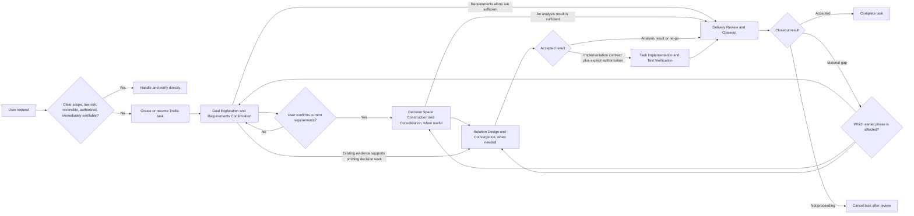

Trellis CLI records the task lifecycle, ordered phase route, artifacts,
acceptance, and implementation authorization. `.trellis/workflow.md` routes the
active task to the relevant phase Skill, which contains that phase's procedure
and diagram.

## Choose a route for the request

This diagram shows common routes, not a mandatory checklist. Trellis CLI records
the selected route and evidence for omitted phases. Goal Exploration and
Requirements Confirmation always establishes a user-confirmed requirements
baseline for a Trellis task. Implementation requires an accepted implementation
contract and separate authorization. Delivery Review and Closeout
checks the current delivery, resolves material gaps or records remaining work,
and determines whether the task can be completed or should be cancelled.

## What coordinates the work

| Component                      | Responsibility                                                                                    |
| ------------------------------ | ------------------------------------------------------------------------------------------------- |
| Trellis CLI                    | Creates and updates task lifecycle, phase route, evidence, acceptance, and authorization records. |
| `.trellis/workflow.md`         | Routes the active task to the relevant phase instructions and supporting components.              |
| Phase Skills                   | Provide the procedure and diagram for their respective phases.                                    |
| Hooks and platform adapters    | Supply current task context where the host supports it.                                           |
| Project specs and task context | Provide guidance and research relevant to the current work.                                       |
| Trellis Teamwork and Paseo     | Support parallel or delegated work when useful; neither owns task or phase state.                 |

Supporting Skills and host tools participate when their responsibilities fit
the work. Their presence does not make them mandatory for every task.

Task lifecycle status does not identify the current business phase. The phase
route and its records are stored in `task.json` under `meta.task_workflow`;
`task.py phase show <task>` displays that route. Use `task.py --help` for the
available task and phase commands.

The session log under `.trellis/workspace/` records session progress. A formal
session handoff package is a separate optional operation for continuing across
sessions; it does not change the task's phase or lifecycle and is not required
to advance or close a task.

For setup, see [Install & First Task](/start/install-and-first-task). For task
commands and context, see [Everyday Use](/start/everyday-use). For module and
platform boundaries, see [Architecture Overview](/advanced/architecture).
