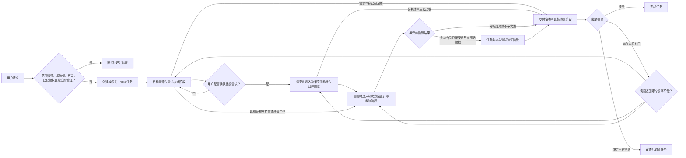

Trellis CLI 记录任务生命周期、有序阶段路线、产物、接受结果和实施授权。
`.trellis/workflow.md` 根据当前任务将工作路由到相应阶段 Skill；Skill 说明该阶段的流程并提供流程图。

## 为请求选择路线

该图展示常见路线，并非必须逐项执行的清单。Trellis CLI 记录所选路线及省略阶段的依据。
目标探索与需求核对阶段始终为 Trellis 任务建立经用户确认的需求基线。实施需要已接受的实施合同和单独的实施授权。
交付审查与现场收尾阶段核对当前交付，解决实质缺口或记录剩余工作，并确定任务是否可以完成或应当取消。

## 各组件如何协作

| 组件                      | 职责                                                         |
| ------------------------- | ------------------------------------------------------------ |
| Trellis CLI               | 创建和更新任务生命周期、阶段路线、证据、接受结果与授权记录。 |
| `.trellis/workflow.md`    | 将当前任务路由到相应阶段指引和协作组件。                     |
| 阶段 Skill                | 提供对应阶段的流程和图示。                                   |
| Hooks 与平台适配器        | 在宿主支持时提供当前任务上下文。                             |
| 项目规范与任务上下文      | 提供与当前工作相关的指导和研究材料。                         |
| Trellis Teamwork 与 Paseo | 在适用时支持并行或委派工作；两者都不拥有任务或阶段状态。     |

当支持 Skill 或宿主工具的职责与当前工作相符时，可以调用它们；组件存在并不意味着每个任务都必须使用。

任务生命周期状态不能表示当前业务阶段。阶段路线和相关记录保存在 `task.json` 的 `meta.task_workflow` 中；
运行 `task.py phase show <task>` 可以查看路线。可用任务和阶段命令以 `task.py --help` 为准。

`.trellis/workspace/` 中的会话日志用于记录会话进度。正式会话交接包是跨会话继续工作的独立可选操作，
不会改变任务阶段或生命周期，也不是推进或关闭任务的前置条件。

安装说明见[安装与首个任务](/zh/start/install-and-first-task)，任务命令与上下文见[日常使用](/zh/start/everyday-use)，
组件边界见[架构概览](/zh/advanced/architecture)。
